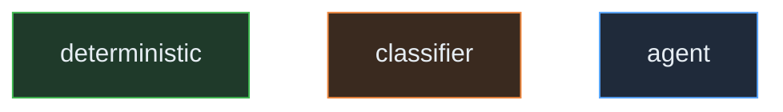
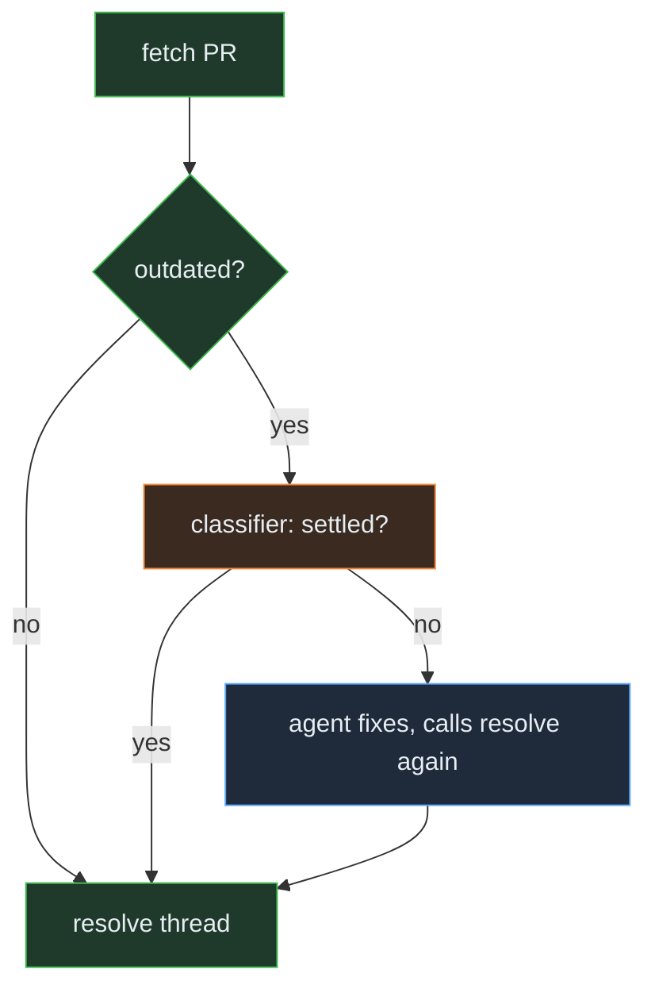
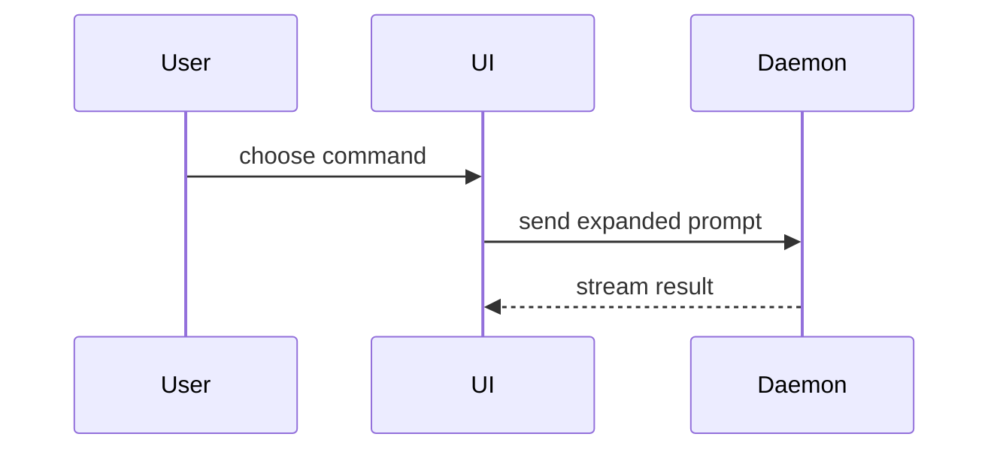

Help the user understand the current topic of conversation visually. Skip the preamble and keep prose brief. Pick the smallest view that makes the key point clear.

- Show logic or an algorithm as pseudocode:

```text
on(save)
  if content is unchanged
    return cached result
  write new content
  return fresh result
```

- Show runtime control flow as a call tree:

```text
submitForm
  createSession
    persistPrompt
    launchAgent
  navigateToSession
```

- Show UI structure as a component tree, including state and module boundaries that matter:

```tsx
<SessionPage> (apps/example/src/routes/session.tsx)
  useSessionEvents()
  <SessionToolbar>
    <RunSkillButton> (packages/ui)
```

- Show file responsibility or a broad refactor as a shallow file tree:

```text
src/
├── commands/       # parses user actions
├── sessions/       # owns session state
└── transport/      # sends API requests
```

- Show component interaction, control flow, or data flow with Mermaid. Follow the Mermaid rules below.

- Use `diff` when the point is what changes and the surrounding shape already exists. Match the diff shape to the topic.

For a component change:

```diff
 <SessionPage>
   useSessionEvents()
   <SessionToolbar>
+    <RunSkillButton />
   <SessionTimeline>
+    <SkillResultCard />
```

For a file-layout change:

```diff
 src/
 ├── commands/
+│   └── show-me.ts       # expands the slash command
 ├── sessions/
-└── transport.ts
+└── transport/
+    ├── client.ts
+    └── stream.ts
```

For a call-tree or call-stack change:

```diff
 submitForm
   createSession
     persistPrompt
+    expandSkillMention
     launchAgent
-  navigateToSession
+  navigateToSession
+    subscribeToEvents
```

For a state or control-flow change:

```diff
 on(save)
-  write content
+  if content is unchanged
+    return cached result
+  write new content
+  invalidate cache
```

- Show the whole block when most of it is new, when omitted context would hide ownership or order, or when the user needs a copyable target shape:

```ts
function expandSkill(command: string): string {
  const skillName = command.slice(1);
  return `use the ${skillName} skill`;
}
```

- For a visual UI, layout, state comparison, or concept too dense for Mermaid, write one focused HTML file: a diagram, an infographic, or a short slide deck, whichever fits the point. Match the product's colors, type, spacing, and components. Use real labels and data, and support desktop and mobile. Then open it for the user:

```
Bash(open path/to/show-me-{description}.html)
```

## Mermaid rules

Pi draws Mermaid as box art in the terminal, so the diagram must fit the terminal width and carry its meaning in color.

- Write every flowchart as `flowchart TD`. A left-to-right flowchart grows wider with each step and breaks in a narrow terminal.
- Color every node in a flowchart, state diagram, or class diagram. Give each role (actor, layer, outcome) one `classDef` with a dark `fill`, a bright `stroke`, and `color:#e6edf3`. Tag nodes with `A:::name` or `class A,B name`. Pi ignores `style` lines.
- If a color means something (who acts, which layer, which outcome), put a legend directly above the diagram: a separate `flowchart TD` block with the same `classDef` lines and one unlinked node per class, labeled with its meaning. If colors only group nodes, skip the legend.
- Sequence diagrams have no classes. Keep them for message order between participants.

Use these colors, one per role:

| Class  | `fill`    | `stroke`  |
| ------ | --------- | --------- |
| green  | `#1f3a2a` | `#3fb950` |
| orange | `#3a2a1f` | `#f0883e` |
| blue   | `#1f2a3a` | `#58a6ff` |
| red    | `#3a1f1f` | `#f85149` |
| purple | `#2d1f3a` | `#a371f7` |







## Guidance

Place each visual next to the short text it supports. Keep only the calls, files, props, states, and boundaries needed to answer the user's current question or to settle the current discussion point.

Use one view or several, rarely all of them. Pick the fewest views that answer the question.
